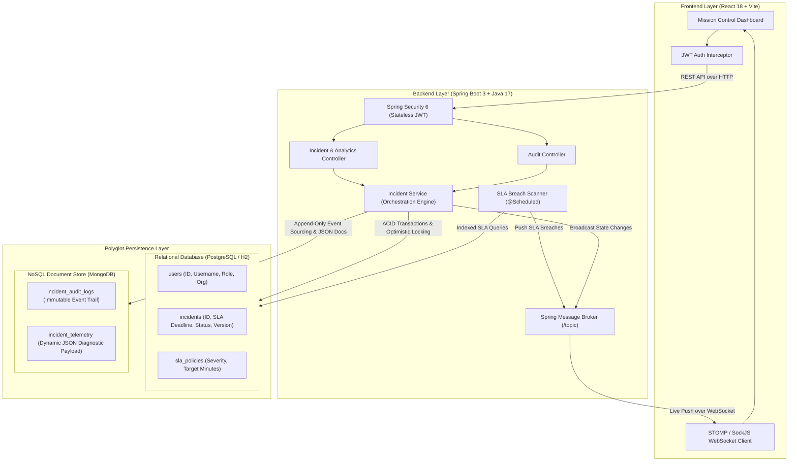

# 🛰️ PulseOps: Polyglot Incident & SLA Governance Platform

> **A production-ready Full-Stack Enterprise Platform engineered from scratch using Java 17, Spring Boot 3, React (JavaScript), SQL (PostgreSQL / H2), and MongoDB.**

[](https://www.oracle.com/java/)
[](https://spring.io/projects/spring-boot)
[](https://react.dev/)
[](https://www.postgresql.org/)
[](https://www.mongodb.com/)
[](https://stomp.github.io/)

---

## 📌 Executive Summary

Modern enterprise cloud architectures (Netflix, Uber, Stripe) cannot afford service downtime without strict SLA tracking and forensic accountability. **PulseOps** solves this by delivering an automated incident orchestration platform that combines:
1. **Strict Relational Transactions (SQL):** Users, role-based permissions, SLA contracts, and incident lifecycle transitions with optimistic locking.
2. **High-Throughput Flexible Storage (MongoDB):** Arbitrary dynamic diagnostic payloads (stack traces, custom metrics, pod metadata) and append-only immutable audit logs.
3. **Real-Time React Dashboard:** Live countdown SLA clocks, bidirectional WebSocket event feeds, and dynamic NoSQL payload builders.

---

## 🏛️ System Architecture



---

## ⚖️ Polyglot Persistence: Why Dual Databases?

| Feature | Relational SQL (PostgreSQL / H2) | NoSQL Document Store (MongoDB) |
|---|---|---|
| **Role in PulseOps** | Transactional Source of Truth | Telemetry & Audit Stream Store |
| **Data Handled** | Users, SLA Policies, Incident Status State Machine | Microservice diagnostic dumps, stack traces, immutable event logs |
| **Data Model** | Normalized schema with foreign key constraints | Flexible schema-free JSON documents |
| **Consistency Guarantee** | Strong ACID, Optimistic Locking (`@Version`) | High write throughput, append-only isolation |
| **Why not just one DB?** | Adding millions of raw stack traces & telemetry dumps into SQL creates severe table bloat & vacuuming overhead. | Incident states require strict relational integrity, foreign keys, and ACID locking to prevent double-resolutions. |

---

## 🚀 Quick Start (Run in 2 Minutes)

### Option 1: Local Development (Zero External DB Needed!)
PulseOps is pre-configured with embedded **H2 Database** and **in-memory fallback caching** for MongoDB, meaning you can start it immediately without installing any external database!

#### 1. Start the Java Backend:
```bash
cd backend
./mvnw spring-boot:run
```
*Backend starts on `http://localhost:8080` with pre-loaded demo data, SLA policies, and sample incidents.*

#### 2. Start the React Frontend:
```bash
cd frontend
npm run dev
```
*Frontend starts on `http://localhost:5173`.*

#### 3. Log In with Default Credentials:
- **Username:** `admin`
- **Password:** `admin123`
- *(Additional test accounts: `sarah_sre` / `password123`, `alex_dev` / `password123`)*

---

### Option 2: Full Docker Compose (PostgreSQL + MongoDB + Backend + Frontend)
If you have Docker running, launch the entire polyglot stack with one command:
```bash
docker compose up --build
```
- **React Web UI:** [http://localhost:5173](http://localhost:5173)
- **Spring Boot API:** [http://localhost:8080](http://localhost:8080)
- **PostgreSQL:** `localhost:5432` (db: `pulseops`)
- **MongoDB:** `localhost:27017` (db: `pulseops`)

---

## 📡 REST API Specifications

| Method | Endpoint | Description | Auth Required |
|---|---|---|---|
| `POST` | `/api/auth/login` | Authenticate & obtain JWT token | No |
| `POST` | `/api/auth/register` | Register new engineer account | No |
| `GET` | `/api/incidents` | List incidents (filter by `status`, `severity`) | Optional (GET) |
| `GET` | `/api/incidents/{id}` | Get incident details enriched with Mongo telemetry | Optional (GET) |
| `POST` | `/api/incidents` | Create incident + save MongoDB telemetry + broadcast WS | Yes (Bearer JWT) |
| `PUT` | `/api/incidents/{id}` | Update status/severity + append MongoDB audit log | Yes (Bearer JWT) |
| `GET` | `/api/audit/incident/{id}` | Retrieve MongoDB immutable audit trail for incident | Optional (GET) |
| `GET` | `/api/analytics/stats` | Active count, SLA breach rate, compliance % | Optional (GET) |

---

## 📚 Resume & Interview Preparation Kits

Included in this repository are comprehensive interview preparation assets:
- 📄 **[RESUME_HIGHLIGHTS.md](./RESUME_HIGHLIGHTS.md):** Pre-written, quantifiable bullet points formatted with the Google XYZ formula for your resume.
- 🎤 **[INTERVIEW_CHEAT_SHEET.md](./INTERVIEW_CHEAT_SHEET.md):** 60-second elevator pitch and answers to 5 deep-dive technical interview questions.
